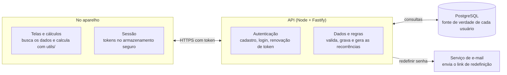

# API do Sobrô? — requisitos e hospedagem

10/10/2026

## 1. Visão geral

A API passa a ser a fonte de verdade do Sobrô?: login obrigatório, todos os dados no servidor e o app como cliente online. O SQLite deixa de ser o armazenamento do app, e não há sincronização.

Hoje não existe servidor nem login, e o único backup é o JSON que a pessoa exporta e importa à mão em Perfil. Com a API, a pessoa troca de celular sem perder nada e os dados deixam de depender de um arquivo guardado por ela.

**Online-first.** Toda tela lê e grava pela API. Sem conexão, o app mostra um aviso e tenta de novo; não guarda alterações para enviar depois. Isso elimina fila de envio, conflitos, cursor, época e ids criados no aparelho, e deixa a API bem menor. Repetir uma gravação que a rede perdeu é protegido por uma chave de idempotência (seção 5). O custo aceito: sem internet o app não mostra os dados.

**Login obrigatório.** O app só abre as abas depois de entrar. Sem sessão válida, aparecem apenas as telas de entrar, criar conta e recuperar senha.

**Contas no app, integridade no servidor.** Resumo do mês, insights, histórico e previsão continuam sendo funções puras em `utils/`: o app busca as linhas e calcula. O servidor guarda, valida, gera as recorrências que vencem e responde as somas pesadas: os totais de cada mês, com os quais o app monta o histórico. A camada `db/` do app mantém os hooks (`useCards`, `useTransactions` etc.) e troca o SQLite por chamadas HTTP, então as telas mudam pouco.

**Consequência:** como cada abertura do app chama a API, a hospedagem que dorme deixou de ser um detalhe. A seção 8 trata disso.

## 2. Modelo de dados

O servidor espelha as tabelas do SQLite atual (`db/schema.ts`, migração v6), com uma mudança: toda linha pertence a um usuário (`user_id`). Os ids continuam inteiros, agora gerados pelo Postgres (`IDENTITY`), então o app, que trata ids como `number`, não muda de tipo. Não há campos de sincronização: excluir apaga de verdade.

| Tabela | Campos principais | Observações |
| --- | --- | --- |
| users | id, email (único), password_hash, created_at | Login próprio. |
| profile | user_id (PK), name, currency, reminders_enabled | Uma linha por usuário. `avatar_uri`, `monthly_budget` e `theme` não vão: a foto foi removida, o orçamento mora em `monthly_budgets` e o tema (claro, escuro ou do sistema) é preferência do aparelho e precisa valer antes do login, então fica só no app. O backup do app traz `theme`; a API o aceita e descarta. |
| categories | id (texto: `food`, `salary`, `transfer`…), name, icon, color, bg | Catálogo global e somente leitura, igual para todos, porque o app não permite criar categorias. Vira por usuário se isso mudar. |
| cards (contas) | id, user_id, name, number (últimos dígitos, opcional), color, light_color, balance | `balance` é o saldo inicial. A API devolve também o saldo atual (inicial + soma das transações), sempre calculado e nunca gravado. |
| transactions | id, user_id, card_id, category_id, name, description, amount, type (`income`/`expense`), occurred_at, created_at, recurrence_id, installment, transfer_id | `amount` com sinal, como no app. As duas pernas de uma transferência compartilham `transfer_id`. |
| recurrences | id, user_id, card_id, category_id, name, description, amount, day, start_month, first_installment, total, end_month, generated_until | Só despesas se repetem. `generated_until` evita gerar a mesma ocorrência duas vezes. |
| monthly_budgets | user_id, month (`YYYY-MM`), amount (nulo = sem orçamento) | Chave (user_id, month). Guarda o mês a partir do qual o valor vale. |
| category_budgets | user_id, category_id, month, amount | Chave (user_id, category_id, month). Mesma lógica do orçamento mensal. |
| goals (caixinhas) | id, user_id, name, target_amount, target_month (YYYY-MM, opcional), color, icon | O dinheiro continua nas contas: a caixinha só reserva parte dele e não mexe em saldo nem nos totais do mês. |
| goal_entries | id, user_id, goal_id, amount, occurred_at | Positivo guarda, negativo retira. O valor da caixinha é a soma das movimentações, calculado e nunca gravado. Retirar mais do que há é recusado. |

**Tabelas de apoio da API** (não existem no app):

| Tabela | Campos principais | Observações |
| --- | --- | --- |
| refresh_tokens | id, user_id, family_id, token_hash, expires_at, replaced_at, revoked_at, created_at | Guarda só o hash do token. `family_id` agrupa os tokens de uma mesma sessão, para revogar todos juntos ao detectar reuso. |
| password_reset_tokens | id, user_id, token_hash, expires_at, used_at | Uso único e validade curta. |
| idempotency_keys | user_id, key, response, created_at | Chave (user_id, key). Apague as de mais de 24 horas. |

**Ao criar a conta:** a API cria o perfil e a conta padrão ("Conta Principal"), o que `seedIfEmpty` fazia no app.

**Isolamento:** toda consulta e toda escrita filtram por `user_id` tirado do token, nunca de um campo enviado pelo app. Um id de outra pessoa responde 404, nunca os dados. Como os ids são sequenciais, essa regra precisa de teste automatizado. Row Level Security no Postgres seria uma segunda barreira, mas com pool de conexões exige configurar o usuário a cada transação (SET LOCAL); é opcional, e os testes de isolamento vêm primeiro.

**Exclusão em cascata:** excluir uma conta apaga as transações dela, as recorrências e a outra perna de cada transferência de que participou (a regra de `deleteCard`), tudo numa única transação SQL.

**Valores em dinheiro:** use `numeric(14,2)` no Postgres, não `float`. A API devolve números em JSON e arredonda para 2 casas na entrada.

**Datas:** `occurred_at` em ISO 8601 UTC, como no app. Meses seguem como texto `YYYY-MM`, lidos em UTC (`utils/month.ts`).

**Fuso horário:** `occurred_at` é um instante em UTC e o mês é lido em UTC, como no app. Isso já erra hoje: uma despesa lançada às 22h de Brasília no último dia do mês é gravada como 01h UTC do dia seguinte e cai no mês seguinte (`registrationSpent` grava `new Date().toISOString()`). Corrija no app antes da API: gravar a data de calendário que a pessoa vê como meio-dia UTC desse dia, o mesmo truque de `monthKeyToDate`. Assim o servidor trata `occurred_at` como data, não como hora. Registros antigos perto da virada do mês podem já estar no mês errado; o `PUT /backup` pode normalizá-los convertendo para a data em `America/Sao_Paulo`. O `day` das recorrências e o "hoje" da geração usam uma única constante de fuso, `America/Sao_Paulo` por padrão; confirme se o app terá usuários fora do Brasil.

## 3. Autenticação e contas

E-mail e senha bastam para a primeira versão, e o login é obrigatório: sem sessão válida o app mostra só as telas de entrar e criar conta. O login é próprio, e não um serviço como o Supabase Auth, porque a hospedagem recomendada é o Heroku (seção 8). Login com Google pode entrar depois, sem mudar o resto.

- **Senha:** hash com argon2id (ou bcrypt). Nunca guardar nem registrar a senha em log.
- **Sessão:** token de acesso JWT de vida curta (cerca de 15 minutos) e token de renovação de vida longa, rotacionado a cada uso e guardado em hash no servidor (tabela `refresh_tokens`). No app, os tokens ficam em `expo-secure-store`. Se a renovação falhar, o app volta para a tela de entrar.
- **Renovação sem corrida:** uma tela dispara várias chamadas ao mesmo tempo, e se o token de acesso expirou todas descobrem juntas. O app renova uma única vez e as demais chamadas esperam o resultado (uma promessa compartilhada). No servidor, o token de renovação recém-trocado continua aceito por uma janela curta (por exemplo, 30 segundos), para cobrir uma resposta perdida; se um token já trocado aparecer fora da janela, a API revoga a família inteira (`family_id`), porque isso indica token roubado.
- **Recuperação de senha:** link por e-mail com token de uso único e validade curta (tabela `password_reset_tokens`). O link abre uma tela do app ou uma página web, que envia o token no corpo de `POST /auth/reset-password`, para ele não ir parar em log de URL. Exige um serviço de envio de e-mail (seção 8).
- **Excluir conta:** apaga o usuário e todas as linhas dele de verdade, não só marca. A Play Store exige que apps com cadastro ofereçam a exclusão dentro do app e também por um link público na web; confirme o requisito atual no Play Console. Uma página no GitHub Pages é estática, então ela só explica e leva ao login: a exclusão em si passa sempre por `DELETE /me`.
- **Limite de tentativas:** rate limit no login e no cadastro (por IP e por e-mail) contra força bruta.

**LGPD:** são dados financeiros pessoais. A pessoa precisa de política de privacidade clara, consentimento no cadastro, e de poder exportar (o JSON de backup já serve) e excluir tudo.

**Transferência internacional:** o Heroku só tem regiões nos EUA e na Europa, sem região no Brasil. Os dados dos usuários ficam fora do país, e a política de privacidade deve dizer isso, já que a LGPD trata de transferência internacional de dados. Confirme a redação com orientação jurídica.

## 4. Endpoints

Com o app online, a API é um REST comum: um recurso por tabela, mais as operações que hoje são funções de `db/`. Tudo sob `/v1`, JSON, HTTPS, com `Authorization: Bearer <token>` fora da autenticação.

| Método e caminho | Para quê | Observações |
| --- | --- | --- |
| POST /auth/register | Criar conta | e-mail e senha → tokens; cria perfil e conta padrão |
| POST /auth/login | Entrar | e-mail e senha → tokens |
| POST /auth/refresh | Renovar o token de acesso | token de renovação → novos tokens |
| POST /auth/logout | Encerrar a sessão neste aparelho | invalida o token de renovação |
| POST /auth/forgot-password | Pedir link de redefinição | sempre 204, exista a conta ou não |
| POST /auth/reset-password | Definir nova senha | token do e-mail e senha nova |
| GET /me, PATCH /me | Ler e alterar o perfil | nome, moeda, lembretes ligados |
| DELETE /me | Excluir a conta e todos os dados | exige a senha de novo |
| GET /categories | Catálogo de categorias | igual para todos |
| GET /cards | Listar contas | inclui o saldo atual de cada uma |
| POST /cards, PATCH /cards/:id | Criar e editar conta | |
| GET /cards/:id/usage | Quantas transações e recorrências vão junto | para a confirmação de excluir (`getCardUsage`) |
| DELETE /cards/:id | Excluir conta | recusa se for a última; cascata na seção 2 |
| GET /transactions | Listar transações | filtros `month`, `cardId`, `categoryId`, `type` e `q` (busca); sem `month`, busca em qualquer mês, com páginas (`limit` e `cursor`) |
| POST /transactions | Criar receita ou despesa | com `repeat`, cria também a recorrência, na mesma transação SQL |
| GET /transactions/:id | Detalhe | |
| PATCH /transactions/:id | Editar | `applyToNext: true` altera também as próximas da recorrência |
| DELETE /transactions/:id | Excluir | se for perna de transferência, apaga as duas |
| POST /transfers | Transferir entre contas | cria as duas pernas de uma vez |
| GET /recurrences | Listar recorrências | o app usa para previsão e lembretes |
| POST /recurrences/:id/end | Encerrar uma recorrência | o que já foi gerado fica (`endRecurrence`) |
| GET /budgets/monthly, PUT /budgets/monthly/:month | Orçamento por mês | `amount` nulo = sem orçamento |
| GET /budgets/categories, PUT /budgets/categories/:categoryId/:month | Limite por categoria | mesma lógica |
| GET /goals, POST /goals | Listar e criar caixinhas | a lista traz o valor guardado de cada uma; o POST aceita Idempotency-Key |
| GET, PATCH e DELETE /goals/:id | Ver, editar e excluir uma caixinha | excluir apaga o histórico; nenhuma conta muda |
| POST /goals/:id/entries, DELETE /goals/:id/entries/:entryId | Guardar, retirar (valor negativo) e apagar uma movimentação | recusa retirar mais do que há na caixinha; aceita Idempotency-Key |
| GET /reports/monthly-totals | Entradas e saídas de cada mês, para o histórico | sem transferências (`transfer_id IS NULL`) |
| GET /reports/category-totals?month= | Total por categoria do mês | sem transferências |
| GET /backup | Baixar tudo no formato do backup atual | serve também para a LGPD |
| PUT /backup | Substituir tudo pelo conteúdo de um backup | valida como `validateBackup` e refaz os ids; é o caminho de migração dos testadores |
| GET /health | Verificar se a API está de pé | 200, sem autenticação e sem tocar no banco |

**Busca:** o filtro `q` roda no servidor, ignorando acento e caixa como `utils/search.ts` faz hoje. No Postgres isso pede a extensão `unaccent`; confirme que o provedor escolhido a oferece. O termo buscado vai na URL, que os logs registram: veja a máscara de logs na seção 7.

**Idempotência:** os `POST` que criam algo (`/transactions`, `/transfers`, `/cards`) aceitam o cabeçalho `Idempotency-Key`, um UUID que o app gera a cada tentativa de salvar. A API guarda a chave por usuário por 24 horas; se a mesma chave chegar de novo, devolve a resposta original em vez de gravar outra vez. Sem isso, um "Tentar de novo" depois de uma resposta perdida duplicaria a transação.

**Saúde:** `GET /health` só diz que o processo está de pé e não toca no banco. `GET /ready` testa o banco, e é ele que o monitoramento da seção 7 usa.

**`PUT /backup` é destrutivo:** substitui tudo numa única transação SQL (se falhar, nada muda), tem um limite de corpo próprio, maior que o das outras rotas, e exige confirmação explícita no app, que já mostra as contagens do arquivo. O servidor refaz os ids de contas, recorrências e transações, inclusive o `transfer_id`, que aponta para a primeira perna da transferência. Ignora o que a v2 não usa, como `avatar_uri` e o `monthly_budget` antigo do perfil, do mesmo jeito que o `validateBackup` já descarta colunas desconhecidas.

**Erros** num formato único: `{ "error": { "code": "validation_failed", "message": "...", "fields": [...] } }`, com 400 (validação), 401 (token), 404 (não existe ou é de outra pessoa), 409 (conflito, como excluir a última conta) e 429 (limite de tentativas).

**Fora da API:** resumo, insights e previsão continuam calculados no app, com as linhas que ele busca.

## 5. Como o app usa a API

Sem banco local, cada tela pede os dados à API e mostra o que veio. Não há fila nem conflito, porque quem grava é sempre a API.

1. Ao abrir uma tela, o hook (`useTransactions`, `useCards` etc.) chama a API com o token. Enquanto espera, a tela mostra um estado de carregamento.
2. Com as linhas na mão, o app calcula com as funções de `utils/` (resumo, insights, histórico, previsão).
3. Ao criar, editar ou excluir, o app chama a API e, se der certo, busca de novo o que a tela mostra. O `notifyDataChanged` e o `useFocusEffect` continuam como gatilho dessa nova busca.
4. Se der erro de rede, a tela mostra o aviso com "Tentar de novo" e nada é alterado na tela como se tivesse sido salvo.
5. Se a API responder 401, o app renova o token uma única vez para todas as chamadas em andamento, e as demais esperam o resultado; se falhar, volta para a tela de entrar.

**Tentar de novo sem duplicar.** Se um `POST` gravar e a resposta se perder, repetir criaria a transação duas vezes. O app gera um `Idempotency-Key` por tentativa de salvar e reenvia o mesmo ao repetir; a API devolve a resposta guardada em vez de gravar de novo (seção 4).

**Recorrências são geradas no servidor.** O que `materializeDueRecurrences` faz hoje ao abrir o app passa a rodar na API. Hospedagem gratuita não garante tarefa agendada, então a geração acontece quando a pessoa chama a API. **Escolha consciente:** ela roda no início de `GET /transactions` e `GET /cards`, ou seja, uma leitura que grava. O custo é atrasar a primeira resposta do dia e dar efeito colateral a um `GET`; o ganho é as listas e o saldo já saírem certos, sem uma chamada a mais. A alternativa é um `POST /recurrences/materialize` que o app chama ao abrir, antes de ler. Não é preciso um campo por usuário para limitar a uma vez por dia: cada recorrência tem `generated_until`, e a pergunta "há algo vencido?" é uma consulta barata e indexada. É segura de repetir por causa do `generated_until`, e a linha da recorrência é travada (`SELECT ... FOR UPDATE`) para duas chamadas ao mesmo tempo não gerarem a mesma parcela. As regras (vencimentos, dia 31 em mês curto, última parcela) estão em `utils/recurrence.ts`, que é TypeScript puro e já tem teste: reaproveite o mesmo arquivo na API.

**Previsão dos próximos meses.** O app busca `GET /recurrences` e calcula as linhas `planned` com o mesmo `utils/recurrence.ts`, como hoje.

**Lembretes.** Continuam sendo notificações locais (`expo-notifications`). O app as reagenda a partir de `GET /recurrences` ao abrir e ao voltar ao primeiro plano. Notificação enviada pelo servidor (push) fica fora desta versão.

**Atomicidade.** Criar transferência, excluir conta, criar transação com recorrência e excluir uma perna de transferência acontecem cada um numa única transação SQL, para nunca sobrar uma perna só.

**Servidor acordando.** Se a resposta demorar alguns segundos (hospedagem que dorme), a tela mostra "Acordando o servidor" em vez de um erro, e repete a chamada. Um cache em memória (por exemplo, TanStack Query) deixa as telas abrirem na hora ao voltar para elas, sem gravar nada em disco.

**Latência.** O Heroku só tem regiões nos EUA e na Europa, então cada chamada feita do Brasil leva uma ida e volta de rede considerável; meça com o app real. Uma tela como o Dashboard precisa de transações, contas, orçamentos, totais e recorrências: busque tudo em paralelo e, se ainda ficar lento, crie um `GET /dashboard?month=` que devolve tudo de uma vez. Mantenha API e banco na mesma região, senão cada consulta paga o trajeto de novo.

**Dados dos testadores.** A v1 guarda tudo no aparelho. Para não perder nada: na v1, exportar o JSON em Perfil, Seus dados; instalar a nova versão e criar a conta; importar o JSON no mesmo cartão, que chama `PUT /backup`. A API valida o arquivo como o `validateBackup` faz e refaz os ids.

## 6. Regras de negócio: app e servidor

O servidor garante a integridade dos dados e gera as recorrências; o app continua calculando o que mostrar. As validações abaixo vêm das regras que já existem em `db/` e `utils/`, e agora a API as aplica em toda escrita, porque não dá mais para confiar no que o app envia.

| Regra a validar no servidor | Origem no app |
| --- | --- |
| `type` é `income` ou `expense`, e o sinal de `amount` combina com ele; valor zero é recusado | `transactions`, `CHECK` do schema |
| `card_id` e `category_id` existem, e a conta é do mesmo usuário | chaves estrangeiras |
| Transferência: as duas pernas têm o mesmo `transfer_id`, valores opostos, contas diferentes e categoria `transfer` | `createTransfer`, `utils/transfer.ts` |
| Uma transferência não se edita; excluir uma perna apaga as duas | `TransferDetails`, `deleteTransfer` |
| A última conta não pode ser excluída | `canDelete` em Carteira |
| `month` no formato `YYYY-MM` válido | `utils/month.ts` |
| Recorrência: `day` de 1 a 31, `total` ≥ 1 ou nulo, `first_installment` ≤ `total`, e só despesa | `utils/recurrence.ts` |
| Texto com limite de tamanho; listas com página máxima | proteção do servidor |

**Fica no app:** resumo do mês e comparação com o mês anterior (`buildSummary`), histórico (`buildHistory`, que monta as linhas a partir dos totais mensais da API e dos orçamentos), insights e dicas (`generateInsights`), limite vigente (`limitsForMonth`), orçamento vigente (`budgetForMonth`) e previsão. São funções puras que recebem linhas, então não precisam de espelho no servidor.

**Passa a ficar no servidor:** gerar as recorrências que vencem, calcular o saldo atual de cada conta, as somas de `/reports` (sempre sem transferências) e a busca.

**App e API evoluem em ritmos diferentes.** A loja pode levar dias para entregar uma versão nova, então a API precisa atender versões antigas do app. Mantenha tudo em `/v1`, nunca remova nem mude o significado de um campo (só acrescente, com valor padrão), faça o app ignorar campos que não conhece e envie a versão dele no cabeçalho `X-App-Version`. Assim, quando uma versão ficar antiga demais, a API responde "atualize o app" em vez de gravar dado incompleto.

## 7. Stack e requisitos não funcionais

Use TypeScript no servidor também: você já domina a linguagem do app, e os tipos e as validações das linhas podem ser reaproveitados.

O app não guarda dados: lê e grava pela API, que é a única a falar com o banco, e o serviço de e-mail só serve para redefinir senha. Sem internet, o app mostra um aviso e tenta de novo.

| Camada | Escolha | Por quê |
| --- | --- | --- |
| Runtime | Node 22 (o mesmo da sua máquina) | Sem diferença entre dev e produção. |
| Framework | Fastify (ou Hono) | Leve, rápido para subir (importa em hospedagem que dorme) e com validação por schema. |
| Validação | Zod | Um schema por tabela, igual à validação do `validateBackup`. |
| Banco | PostgreSQL | Relacional como o SQLite atual, com `numeric` para dinheiro. |
| Acesso ao banco | Drizzle ORM + drizzle-kit | Migrações versionadas em arquivos, como o `MIGRATIONS` do app. |
| Senha e token | argon2 e jose (JWT) | Padrão atual, sem inventar criptografia. |
| Testes | Vitest | Mesmo estilo dos testes `.test.ts` do app. |
| Deploy | Dockerfile simples e variáveis de ambiente (`DATABASE_URL`, `JWT_SECRET`) | Trocar de hospedagem vira só mudar configuração. |

**Requisitos não funcionais**

- **Disponibilidade:** com o app online, API fora do ar significa app sem dados. Por isso a hospedagem precisa ficar sempre ligada (seção 8), e `/ready` deve ser monitorado, com aviso quando cair. O plano Essential do Heroku Postgres espera 99,5% de disponibilidade por mês (menos de 4 h fora do ar) e faz manutenção sem aviso.
- **Saúde:** `/health` não toca no banco e diz só que o processo está de pé; `/ready` testa o banco. O servidor sobe em poucos segundos.
- **Índices:** `(user_id, occurred_at)` em `transactions`, que é a consulta de toda tela; `(user_id, card_id)` e `(user_id, recurrence_id)` para as buscas por conta e por recorrência.
- **Pool de conexões:** o Essential-0 aceita 20 conexões no total. Limite o pool da API a cerca de 10, para sobrar folga para migrações e para o `psql`.
- **Segurança:** só HTTPS, segredos em variáveis de ambiente (nunca no repositório), limite de tamanho de corpo e rate limit.
- **Logs sem dados sensíveis:** o router do Heroku registra o caminho com a query string, e `GET /transactions?q=` põe o termo buscado na URL. Ative `heroku features:enable http-router-no-log-query` e configure o pino para mascarar `q` e qualquer token. Logs não levam valores nem descrições de transações.
- **Código compartilhado:** `utils/recurrence.ts`, `utils/month.ts` e `utils/transfer.ts`, com seus testes, rodam no app e na API. Copie os arquivos, publique um pacote interno ou use um monorepo; evite manter duas versões.
- **Testes de integração:** Vitest com um Postgres de teste, incluindo o caso de um usuário tentando ler ou alterar dados de outro, que deve responder 404.
- **Contrato (opcional, depois):** o Fastify gera OpenAPI a partir de JSON Schema. Com Zod, isso exige `fastify-type-provider-zod` e `@fastify/swagger`; não vem de graça. Serve para o cliente do app ser tipado e não é requisito da primeira versão.
- **Backup do banco:** agora o servidor guarda a única cópia dos dados. Use o PGBackups do Heroku (`heroku pg:backups:schedule`): a documentação lista o plano Essential com retenção diária de 7 dias, semanal de 1 semana e 5 backups manuais, mas não confirma o agendamento nesse plano, então teste o comando. Não há aviso se o agendamento falhar, então confira à mão. Guarde também uma cópia fora do Heroku (`pg_dump` agendado por GitHub Actions) para o caso de perder a conta. O `GET /backup` serve de cópia para quem quiser.
- **Observabilidade mínima:** log estruturado (pino) com o id da requisição.

## 8. Hospedagem gratuita

**Recomendação: Heroku com dyno Basic e Postgres Essential-0, pagos pelo crédito do Student Pack.** Com o app online e login obrigatório, toda abertura chama a API, e um servidor que dorme deixa a pessoa olhando uma tela de carregamento por cerca de um minuto.

Se você não tiver cartão ou ainda não tiver 18 anos, a alternativa sem custo é Render com Neon, aceitando o sono e mostrando "Acordando o servidor" no app (seção 5).

Valores conferidos nas páginas oficiais em 10/10/2026. Planos gratuitos mudam com frequência; confirme antes de contar com eles.

| Opção | O que roda | Custo | Limite que pesa | Quando escolher |
| --- | --- | --- | --- | --- |
| [Heroku](https://www.heroku.com/github-students) (Student Pack) | Dyno Basic (US$ 7, [sempre ligado](https://www.heroku.com/pricing)) + Postgres Essential-0 (US$ 5, 1 GB) | US$ 12 por mês, dentro do crédito de US$ 13 por mês por 24 meses | Exige 18 anos ou mais e cartão válido; o que passar de US$ 13 é cobrado no cartão. O crédito do mês não acumula. Postgres: 20 conexões. O dyno Eco (US$ 5) dorme após 30 min sem uso, então não serve. Plano Essential: sem rollback, disponibilidade esperada de 99,5% por mês e manutenção sem aviso. Regiões só nos EUA e na Europa. | **Padrão.** API sempre ligada. Depois dos 24 meses, cerca de US$ 12 por mês ou migrar. |
| [Render](https://render.com/docs/free) (API) + [Neon](https://neon.com/pricing) (Postgres) | API Node no Render, banco no Neon | R$ 0, permanente | Render: 750 h por mês e dorme após 15 min sem tráfego, voltando em cerca de 1 min. Neon: 1 GB por projeto, 100 horas de computação, dorme após 5 min, 5 GB de saída de dados. | Sem cartão ou sem 18 anos. A primeira abertura depois de um tempo parado fica lenta. |
| [Supabase](https://supabase.com/pricing) | Postgres + login prontos, quase sem servidor próprio | R$ 0 | 500 MB de banco, 2 projetos ativos, 50 mil usuários ativos por mês, 5 GB de saída; projeto pausa após 1 semana sem uso, e com o app online isso o deixa fora do ar até ser reativado; sem backup automático. | Se preferir escrever menos código: troca o login e a recuperação de senha por serviços prontos. O risco da pausa pesa mais agora. |
| [Azure for Students](https://azure.microsoft.com/en-us/free/students) | App Service + PostgreSQL Flexible Server | Crédito de US$ 100 por 12 meses (renovável enquanto for estudante), sem cartão | O App Service gratuito dá só 1 hora por dia, então não serve como API sempre ligada sem gastar o crédito. O PostgreSQL gratuito dura 12 meses (750 h, 32 GB). Só para estudante em tempo integral. | Se quiser aprender Azure. É a opção com mais configuração. |
| Postgres gratuito do Render | Não usar | — | Expira 30 dias após a criação e é apagado após mais 14 dias; sem backup. | Evitar. Use o Neon. |

**Regiões e latência:** o Heroku só tem regiões nos EUA e na Europa, e o Render tem Oregon, Ohio, Virginia, Frankfurt e Singapura: nenhum dos dois tem região no Brasil. Neon e Supabase têm São Paulo (`sa-east-1`), mas banco em São Paulo com API nos EUA só piora a latência, porque cada consulta cruza o continente. API e banco ficam na mesma região. No Heroku, a região `us` costuma ficar mais perto do Brasil que a `eu`; meça com o app real (seção 5).

**O que mais o Student Pack e os planos gratuitos resolvem**

- **E-mail de redefinição de senha:** [Resend](https://resend.com/pricing) no plano gratuito dá 3.000 e-mails por mês, no máximo 100 por dia. O Render bloqueia as portas SMTP (25, 465, 587), então envie pela API HTTP do Resend, não por SMTP.
- **Domínio e certificado:** o [Student Pack](https://education.github.com/pack) lista um domínio .me por 1 ano e 1 certificado SSL grátis pela Namecheap.
- **Página da política de privacidade:** GitHub Pages, também listado no pack, serve de endereço público exigido pela loja.
- **DigitalOcean:** blogs de terceiros citam US$ 200 de crédito, mas essa oferta não aparece na página oficial do pack consultada em 10/10/2026. Confira antes de contar com ela.
- **Não avaliados:** Fly.io, Railway e Koyeb nas páginas oficiais. Comparativos de terceiros dizem que os planos gratuitos deles encolheram, então ficaram fora da recomendação.

**Para não ficar preso a um provedor:** mantenha a API em um Dockerfile e leia tudo de variáveis de ambiente. Mudar de Render para Heroku vira trocar o `DATABASE_URL` e refazer o deploy; o app só precisa saber a URL base da API.

**Cuidados com custo:** no Heroku, configure um alerta de gasto e confira o que está ligado, porque o cartão paga o que passar do crédito. No Render, sem forma de pagamento cadastrada, estourar a franquia suspende os serviços até o mês seguinte; com cartão cadastrado, o excesso é cobrado. Por isso, não cadastre cartão lá sem necessidade.

## 9. Etapas e mudanças no app

A versão atual do app, local e sem login, continua com os testadores até a v2 ficar pronta. A v2 só sai quando a API estiver no ar, porque o app passa a depender dela.

1. **Agora:** terminar os testes da v1 local e publicar para os testadores. Corrigir já o fuso das datas (seção 2), porque o erro existe na v1, e pedir aos testadores que exportem o backup em Perfil, Seus dados, antes de atualizarem para a v2.
2. **API mínima:** repositório separado, Fastify + Drizzle, `/health` e `/ready`, cadastro, login, renovação e saída, com perfil e conta padrão criados no cadastro e as tabelas `refresh_tokens`, `password_reset_tokens` e `idempotency_keys`; deploy na hospedagem escolhida.
3. **Dados:** contas, transações, transferências, orçamentos, limites e categorias, com testes de integração, incluindo o isolamento entre usuários e a idempotência dos `POST`.
4. **Regras do servidor:** geração das recorrências com o `utils/recurrence.ts` compartilhado, `/reports`, busca e `PUT /backup` com validação.
5. **App v2:** telas de login, cadastro e recuperar senha; cliente HTTP com renovação única do token e `Idempotency-Key`; `db/` trocado por chamadas à API mantendo os hooks; estados de carregando e de erro nas telas.
6. **Migração dos testadores:** o cartão Seus dados passa a importar o JSON da v1 pela API.
7. **Fechamento:** recuperação de senha por e-mail, excluir conta no app e página pública de exclusão (GitHub Pages) ligada à API, política de privacidade com a transferência internacional, backups agendados no Heroku e cópia fora dele.
8. **Publicar a v2** para os testadores antes de abrir para mais gente.

**O que muda no app**

- Rotas novas de entrar, criar conta e recuperar senha, fora das abas. `app/index.tsx` deixa de redirecionar direto para `/dashboard`: sem sessão, vai para o login. As rotas novas entram no `_layout.tsx` pelo nome completo (por exemplo `login/index`).
- Um `AuthProvider` acima do `Stack`, ao lado do `FeedbackProvider`, guardando a sessão e renovando o token.
- Um cliente HTTP em pasta própria (por exemplo `api/`) e a camada `db/` reescrita sobre ele, com os mesmos hooks. O `notifyDataChanged` continua como gatilho de nova busca.
- Sai o que só existia por causa do banco local: `SQLiteProvider`, `migrateDbIfNeeded`, `seedIfEmpty` e a geração de recorrências do `RecurrenceSync`, que fica só com os lembretes.
- Tokens em `expo-secure-store`. É um módulo nativo: exige novo build, não só atualização de JS.
- Perfil ganha sair da conta e excluir conta. Textos em `-type.ts`, avisos por `showToast`, nunca `Alert.alert`.
- O `CLAUDE.md` precisa ser atualizado: ele descreve o app como local-first, sem backend nem login.

**Decisões em aberto**

- Manter o `expo-sqlite` por mais uma versão para importar os dados locais sozinho, ou pedir só o JSON exportado.
- Compartilhar `utils/` com a API por cópia, pacote interno ou monorepo.
- Confirmar o e-mail no cadastro. Sem confirmação, um e-mail digitado errado inviabiliza a recuperação de senha. Sugestão: confirmar sem bloquear o uso do app, exigindo a confirmação só para recuperar a senha.
- Fuso: `America/Sao_Paulo` para tudo, ou um fuso por usuário (seção 2).
- Gerar as recorrências dentro do `GET` (como está) ou num `POST /recurrences/materialize` chamado ao abrir o app (seção 5).
